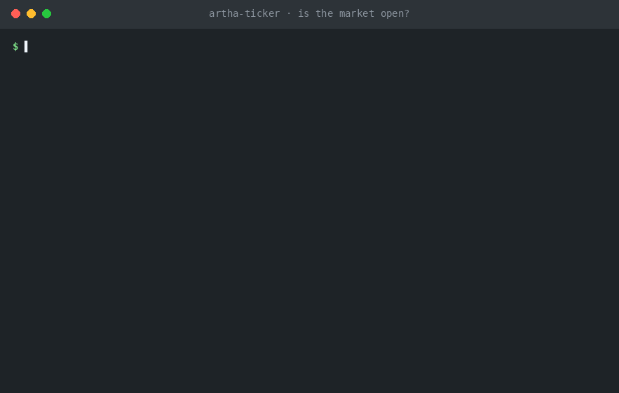
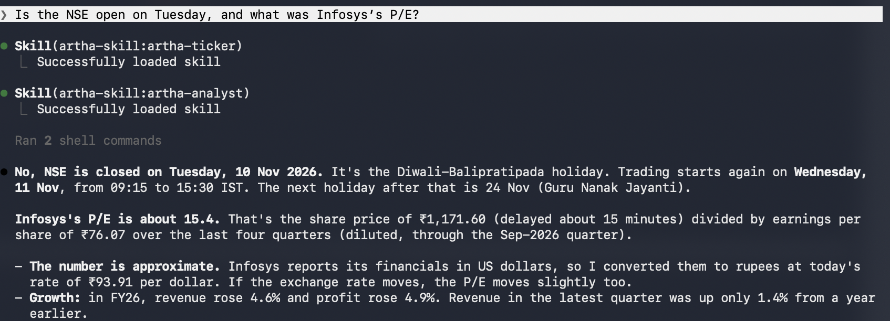
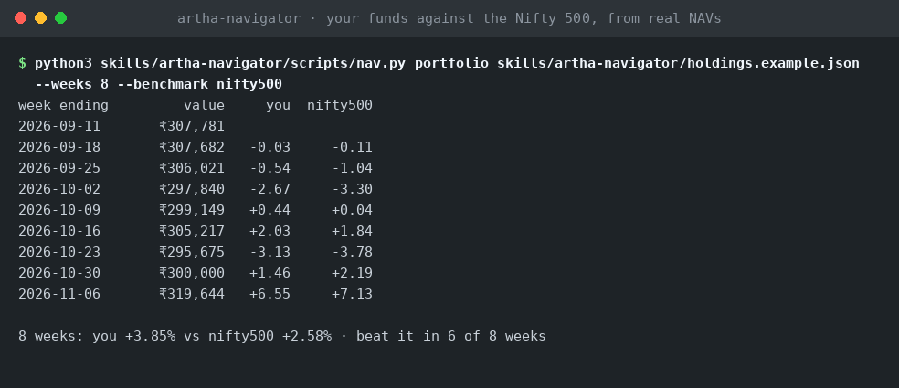
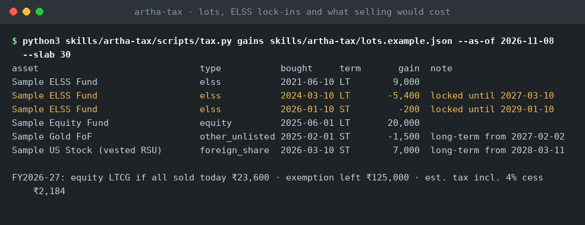
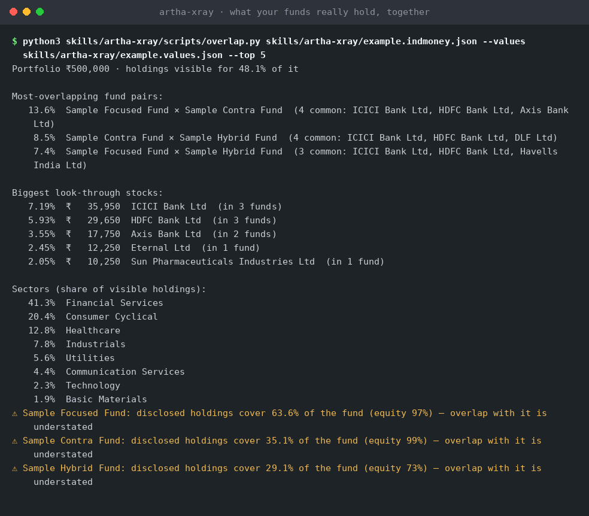

<div align="center">




</div>

<h3 align="center">Open-source Claude skills for Indian investors</h3>

<p align="center"><b>Fund NAVs, NSE/BSE prices, company financials, news, screens, fund overlap and tax estimates, with the silent data traps already handled.</b></p>

<p align="center">
  <a href="LICENSE"></a>
  <a href="https://code.claude.com/docs/en/overview"></a>
  
  
  <a href="https://github.com/gpavan1992/artha-skill/actions/workflows/ci.yml"></a>
</p>

<p align="center">
  <a href="#quick-start"><b>Install</b></a> ·
  <a href="https://github.com/gpavan1992/artha-skill/issues"><b>Report a Bug</b></a>
</p>

<p align="center">
  <a href="#screenshots">Screenshots</a> · <a href="#quick-start">Quick Start</a> · <a href="#architecture">Architecture</a> · <a href="#roadmap">Roadmap</a>
</p>

---

## The Problem

Indian portfolio data fails quietly. Every row below happened while these skills were being built and tested against real data, and every one produced a plausible-looking number.

| What went wrong | What a naive lookup showed | What Artha does |
|---|---|---|
| A merged fund keeps its old scheme code, and its history stops years ago | A stale series that looks like a live fund | Resolves only active AMFI schemes; flags any history older than 7 days |
| One fund house calls the Growth option **Cumulative** | A search for a Nifty 50 index fund matched the Nifty Next 50 fund | Alias-aware resolver that ranks the true match first and shows a confidence score on every result |
| Infosys reports in **US dollars** while its share price is in ₹ | A P/E of about 1,450 | Converts at today's rate, says so, and drops the figure if the rate is unavailable |
| A 1:1 bonus issue halves raw EPS | "Profit halved" | Compares diluted, restated EPS only; detects splits and uses adjusted closes |
| NSE was shut on Friday 2 Oct 2026 | A missing Friday close | Uses the last trading close and says which day it is |

A wrong number that looks right is worse than an error. Artha's rule: **warn, convert or refuse. Never guess.**

---

## What Artha Does

Eight skills. Each is a `SKILL.md` that tells Claude when to use it and what to watch for, plus a standard-library Python script that fetches and computes the numbers.

### 📈 artha-navigator: real fund NAVs

Resolve any fund to its current AMFI scheme code. Get 1W / 1M / 3M / 6M / 1Y / 3Y / 5Y returns and 1Y max drawdown, or the weekly value of a whole portfolio against the Nifty 50 or Nifty 500. Every week comes from a real NAV; nothing is estimated.

### 🕒 artha-ticker: NSE/BSE prices and calendar

Quotes, history, week-over-week moves, split and bonus handling, and the NSE trading calendar in IST, including holidays and Muhurat sessions. Answers "is the market open Tuesday?" and "how did my stocks do this week?"

### 🧮 artha-analyst: reported financials

Annual and quarterly revenue, profit and operating margin, growth, diluted EPS, P/E, ROE, debt-to-equity and free cash flow. Flags currency, bonus/split and one-off-profit traps, and handles bank metrics separately.

### 📰 artha-pulse: why did it move?

News headlines that actually name the company, ranked by importance, plus official NSE announcements (results, dividends, orders, management changes, ratings) when you opt in with `--nse`. Tracks what you have already seen so repeat runs show only what is new.

### 🔎 artha-scout: screen against your rules

Screen the Nifty 50/100/200/500, Next 50, Midcap 150, Smallcap 100 or your own list against rules you write in JSON. Returns passes, near-misses (failing exactly one rule, with the gap) and failures with reasons.

### 🔬 artha-xray: what your funds really hold

Look-through stock and sector exposure across all your funds, the rupees you effectively hold in each stock, and which fund pairs largely duplicate each other. Says how much of each fund's portfolio is actually disclosed, so understated overlap is never hidden.

### 🧾 artha-tax: capital-gains estimates

Short vs long term by asset class, the ₹1.25L LTCG exemption, "what would selling X cost me", loss-harvesting candidates and ELSS 3-year lock-in dates, using FY 2026-27 rules. Switching funds is treated as the taxable sale it is.

### 💳 artha-ledger: spend from bank alerts

Turns card and UPI alert emails into a categorised spending summary: categories, top merchants, per-card totals, refunds. Never outputs card numbers, UPI IDs or the names of people paid.

---

## Data Sources

Artha reads public data only. No account, no login, no API key.

| Source | Used by | What it provides | Key needed |
|---|---|---|---|
| **AMFI** (`NAVAll.txt`) | navigator | Active scheme list, ISINs, daily NAV | No |
| **mfapi.in** | navigator | Full daily NAV history per scheme | No |
| **Yahoo Finance** (public endpoints) | ticker, navigator, analyst | Prices, history, splits, index levels, fundamentals, USD/INR | No |
| **NSE corporate announcements** (opt-in) | pulse | Official company filings, only with `--nse` | No |
| **Google News** (India RSS) | pulse | Headlines that name the company | No |
| **NSE index lists** | scout | Constituents of Nifty 50/100/200/500, Midcap 150, Smallcap 100 | No |
| **Bundled holiday list** | ticker | NSE trading holidays and special sessions (2026), compiled from public tables. 2027 is added when NSE publishes it (late December); until then the calendar says so | n/a |

Yahoo, Google and NSE endpoints are public but unofficial. They can change or rate-limit automated requests. When one does, the skills say so instead of returning a stale number. Confirm any date you plan around, such as a holiday, on [nseindia.com](https://www.nseindia.com).

### Responsible data use

- **Artha identifies itself.** Every request carries the User-Agent `artha-skill/<version> (+repository URL)`. The one exception is the opt-in NSE call below.
- **NSE filings are opt-in.** NSE refuses clients that identify themselves, so `--nse` has to send a browser-style User-Agent and a cookie handshake to get an answer. It is off by default, Claude asks before using it, and whether to use it is your decision: check NSE's terms first. Everything else in Artha works without it.
- **Low volume.** Requests run one at a time with a short pause between uncached fetches, and results are cached on disk (minutes to a day) so repeat questions do not hit the source again.
- **No logins, no workarounds.** Artha never uses credentials, solves CAPTCHAs or touches an account. When a source blocks or fails, it says so instead of returning a stale number.
- **Full detail** is in [PRIVACY.md](PRIVACY.md).
- **Personal analysis.** Artha is built for analysing your own portfolio. It does not host, resell or redistribute any provider's data, and each provider's terms apply to how you use it.

---

## By the Numbers

| | |
|---|---|
| **8** | skills, each with its own `SKILL.md` and script |
| **6** | live public data sources |
| **0** | API keys and third-party dependencies (Python standard library only) |
| **13** | live checks in `tests/smoke.sh` |

---

## Compared to a typical portfolio-tracker app

| | **Artha** | Typical tracker app |
|---|---|---|
| **Where your holdings live** | In files on your machine; nothing is uploaded by Artha | On the vendor's servers |
| **Source code** | Fully open, MIT: read every line | Usually closed |
| **Pricing** | Free | Often free tier plus subscription |
| **How you ask** | Plain language to Claude: "how did my funds do against the Nifty 500?" | Fixed screens and filters |
| **Customization** | Edit the screener rules, categories and tax lots, or fork it | Feature requests into a backlog you do not control |
| **Exit** | Delete the folder | Account closure and data export |

Artha does not compete on a polished app. It competes on being right and on showing its work.

---

## Two editions

This branch (`main`) is the full edition: eight skills backed by tested Python scripts, caches and CI. Install it from GitHub:

```
claude plugin marketplace add gpavan1992/artha-skill
claude plugin install artha-skill@artha
```

The [`directory` branch](https://github.com/gpavan1992/artha-skill/tree/directory) holds a second, instruction-only edition of the same eight skills, with no scripts, built for the Claude plugin directory, which accepts only text, JSON and images from unverified publishers. In it, Claude fetches the public data and does the arithmetic itself, so results are less repeatable, it screens about 15 stocks at a time, and it does not read NSE filings. That branch is a separate history and is never merged into `main`.

---

## Is this for you?

**Good fit if you:**

- Invest in Indian mutual funds and stocks and want checkable numbers behind your own decisions
- Use Claude Code (or another Claude surface that supports plugins) and are comfortable running a command
- Want warnings, not silent guesses, when data is stale, converted or approximate

**Not a fit if you:**

- Want buy, sell or "which fund is best" recommendations. Artha reports and flags; it never recommends
- Want to place orders. It has no broker access and no write access to any account
- Need a point-and-click dashboard. This is a set of skills, not an app
- Need figures to file a tax return. Tax output is an estimate; confirm with a chartered accountant

---

## Screenshots

|  |  |
|---|---|
| *Claude Code: the market calendar and a company's P/E in one answer* | *artha-navigator: weekly value vs the Nifty 500, from real NAVs* |
|  |  |
| *artha-tax: lots, ELSS lock-ins and what selling would cost* | *artha-xray: look-through overlap, with disclosure warnings* |

All terminal images are real script output on the bundled **sample data** (invented holdings), generated by running the skills. They are not mock-ups.

---

## Quick Start

**Requirements:** Python 3.9+ and an internet connection. No keys, no installs beyond the plugin.

### Option 1: Claude Code (recommended)

```bash
claude plugin marketplace add gpavan1992/artha-skill
claude plugin install artha-skill@artha
claude
```

Then ask in plain language:

- "Is the NSE open on Tuesday, and what is Infosys's P/E?"
- "How did my funds do against the Nifty 500 over the last 12 weeks?"
- "What would it cost in tax to sell 200 units of my ELSS fund today?"
- "Which of my funds hold the same stocks?"

### Option 2: try it for one session

Clone the repository from [GitHub](https://github.com/gpavan1992/artha-skill) (the green **Code** button), then start Claude Code with the plugin folder:

```bash
claude --plugin-dir ./artha-skill
```

### Option 3: use the scripts directly, no Claude

Every script is plain Python with `--help`.

```bash
python3 skills/artha-ticker/scripts/prices.py market
python3 skills/artha-analyst/scripts/fund.py INFY RELIANCE
python3 skills/artha-navigator/scripts/nav.py resolve "UTI Nifty 50 Index"
python3 skills/artha-pulse/scripts/news.py INFY --days 7
python3 skills/artha-scout/scripts/screen.py --index nifty50 --rules skills/artha-scout/rules.example.json
python3 skills/artha-tax/scripts/tax.py gains skills/artha-tax/lots.example.json --slab 30
```

### Bring your own data

Artha ships with invented sample files. Copy one, replace the values with yours, and keep your copy out of git.

| You provide | Used by | Start from |
|---|---|---|
| Fund units or values | navigator | `skills/artha-navigator/holdings.example.json` |
| Stock holdings | ticker | `skills/artha-ticker/stocks.example.json` |
| Tax lots (buy date, units, cost) | tax | `skills/artha-tax/lots.example.json` |
| Fund holdings and rupee values | xray | `skills/artha-xray/example.indmoney.json`, `example.values.json` |
| Screening rules | scout | `skills/artha-scout/rules.example.json` |
| Bank alert emails (as JSON) | ledger | `skills/artha-ledger/alerts.example.json` |

`.gitignore` already excludes the cache folders. Never commit files that contain your real holdings.

### Configuration (optional)

| Variable | Purpose | Default |
|---|---|---|
| `MFNAV_CACHE` | NAV cache folder (navigator) | `.mfnav-cache` |
| `PRICES_CACHE` | Price cache folder (ticker) | `.prices-cache` |
| `FUND_CACHE` | Fundamentals cache folder (analyst) | `.fund-cache` |
| `NEWS_CACHE` | News cache folder (pulse) | `.news-cache` |

<details>
<summary><b>Network access needed</b></summary>

`portal.amfiindia.com`, `api.mfapi.in`, `query1.finance.yahoo.com` and `query2.finance.yahoo.com`, `www.nseindia.com`, `nsearchives.nseindia.com`, `www.niftyindices.com`, `news.google.com`. If your environment restricts outbound domains, allow these.

</details>

---

## Architecture

```
┌──────────────────────────────────────────────────────┐
│       Claude  (Claude Code · Cowork · plugin-aware)   │
│   "How did my funds do against the Nifty 500?"        │
└──────────────────────────┬───────────────────────────┘
                           │ picks a skill from its description
┌──────────────────────────▼───────────────────────────┐
│                 Artha skills (SKILL.md)               │
│  navigator │ ticker │ analyst │ pulse │ scout         │
│  xray │ tax │ ledger                                  │
│  when to use · known traps · how to report            │
└──────────────────────────┬───────────────────────────┘
                           │ runs
┌──────────────────────────▼───────────────────────────┐
│          Python scripts  (stdlib only, no keys)       │
│  resolve · returns · quote · weekly · gains · screen  │
│  short on-disk caches                                 │
└───────────┬──────────────────────────────┬───────────┘
            │ public data                  │ your files
┌───────────▼───────────────┐  ┌───────────▼───────────┐
│ AMFI · mfapi.in · Yahoo   │  │ holdings · lots ·     │
│ NSE · Google News ·       │  │ rules · fund holdings │
│ NSE index lists           │  │ (never leave your     │
│                           │  │  machine via Artha)   │
└───────────────────────────┘  └───────────────────────┘
```

**Key design decisions:**

- **Scripts compute, Claude explains.** Numbers come from deterministic code, not from a model's memory. The `SKILL.md` tells Claude how to report them, including every warning the script raises.
- **Traps are documented per skill.** Stale scheme codes, `Cumulative` = Growth, currency of reporting, bonus-adjusted EPS and holiday gaps are written down where the skill is read, so they are handled every time.
- **Warn, convert or refuse.** A figure is flagged, converted with the rate disclosed, or withheld. It is never silently guessed.
- **Observations, never advice.** Artha states what the data shows. It does not say buy, sell or switch.
- **No credentials, no write access.** There is no broker connection, no login and nothing to configure beyond optional cache folders.

---

## Privacy and Safety

| Control | Status |
|---|---|
| Runs on your machine; Artha uploads nothing | ✅ |
| No API keys, passwords or tokens requested | ✅ |
| No telemetry | ✅ |
| Card numbers, UPI IDs and payee names never output | ✅ |
| Bundled examples use invented data only | ✅ |
| Read-only: no orders, no account access | ✅ |
| Self-identifying User-Agent on every request, except opt-in NSE filings | ✅ |
| Open source: every line auditable | ✅ |
| Data-source guarantees | ○ Public, unofficial endpoints; can change without notice |
| NSE official filings | ○ Opt-in (`--nse`); NSE only serves browser-style requests |
| Tax outputs accepted for filing | ○ Estimates only; confirm with a chartered accountant |

**Privacy and security:** [PRIVACY.md](PRIVACY.md) lists exactly what stays on your machine and what each source receives. The skills that handle your personal data (`artha-tax`, `artha-xray`, `artha-ledger`) make no network requests at all. Report vulnerabilities privately as described in [SECURITY.md](SECURITY.md).

**On regulation:** Artha is not a SEBI-registered investment adviser or research analyst, and nothing it produces is investment advice.

---

## Roadmap

**v0.1: Current**

- ✅ Real fund NAV history, returns and portfolio-vs-benchmark series
- ✅ NSE/BSE prices, history and trading calendar (2026)
- ✅ Reported financials with currency and bonus/split traps flagged
- ✅ Company-named news, with official NSE announcements on request (`--nse`)
- ✅ Rules-based screener over seven NSE indices
- ✅ Fund look-through overlap with disclosure warnings
- ✅ FY 2026-27 capital-gains estimates and ELSS lock-ins
- ✅ Spend parsing from bank alerts
- ✅ Strict plugin validation and live smoke tests

**v0.2: Next**

- [ ] 2027 NSE holiday list, checked against NSE's circular (NSE published the 2026 list in late December 2025)
- [ ] Price and rule alerts between runs
- [ ] SIP-aware returns (XIRR) alongside the weekly portfolio series
- [ ] Claude plugin directory listing (instruction-only edition on the `directory` branch, in progress)

**v1.0: Future**

- [ ] Optional MCP connector so the same data works outside Claude Code
- [ ] More asset classes: bonds, REITs, gold ETFs in the portfolio series

*Roadmap items are intentions, not commitments.*

---

## Contributing

Artha is open source under MIT and welcomes contributions. See [CONTRIBUTING.md](CONTRIBUTING.md).

**Ways to contribute:**

- Report a data trap you hit: a number that looked right and was not (use the *Data source broke* issue template)
- Add or correct tax rules, with the source
- Add a screener metric or a fund-house alias
- Improve documentation and examples
- Star the repo: it helps more Indian investors find it

**To contribute code:**

1. Fork the repository
2. Create a feature branch
3. Run `python3 tests/static_check.py` and `bash tests/smoke.sh`
4. Open a pull request with a clear description

---

## Stack

| Layer | Technology |
|---|---|
| Skill instructions | Claude Agent Skills (`SKILL.md`) |
| Packaging | Claude Code plugin and marketplace manifests |
| Logic | Python 3.9+, standard library only |
| Data | AMFI, mfapi.in, Yahoo Finance, NSE, Google News RSS |
| Tests and CI | Bash smoke tests, a static checker, GitHub Actions |

---

## License

Artha is licensed under **MIT**.

This means:

- ✅ Free to use for any purpose
- ✅ Free to modify and extend
- ✅ Commercial use permitted
- ✅ Free to redistribute, including in closed-source work
- ⚠️ Keep the copyright and licence notice with copies

---

## Built By

**Pavan Galiveeti**, Lead PM building AI products for enterprise teams. Built with [Claude](https://claude.com) as AI pair programmer. Building in public. All feedback welcome.

- LinkedIn: [linkedin.com/in/pavangaliveeti](https://linkedin.com/in/pavangaliveeti)
- GitHub: [github.com/gpavan1992](https://github.com/gpavan1992)

---

*Artha is not investment advice and is not a SEBI-registered adviser.*
*Data comes from public sources that can be wrong or delayed. Verify before you act.*
