<p align="center">
  
</p>

<p align="center">
  <a href="https://github.com/gpavan1992/artha-skill/actions/workflows/ci.yml"></a>
  &nbsp;
  <a href="https://code.claude.com/docs/en/overview"></a>
  &nbsp;
  
  &nbsp;
  
  &nbsp;
  <a href="LICENSE"></a>
</p>

<p align="center">
  Open-source Claude skills for Indian investors.<br>
  Mutual fund NAVs, NSE/BSE prices, company financials, news, screens, fund overlap,<br>
  capital-gains estimates and spend summaries, with the silent data traps already handled.
</p>

<p align="center">
  <a href="#quick-start"><b>Quick start</b></a>
  &nbsp;&nbsp;&nbsp;
  <a href="#the-eight-skills"><b>Skills</b></a>
  &nbsp;&nbsp;&nbsp;
  <a href="#see-it-work"><b>See it work</b></a>
  &nbsp;&nbsp;&nbsp;
  <a href="#how-a-number-gets-checked"><b>How it works</b></a>
  &nbsp;&nbsp;&nbsp;
  <a href="#use-it-with-your-brokers-connector"><b>With your broker</b></a>
  &nbsp;&nbsp;&nbsp;
  <a href="#data-sources"><b>Data sources</b></a>
  &nbsp;&nbsp;&nbsp;
  <a href="#customization"><b>Customization</b></a>
</p>

> [!NOTE]
> Artha is an independent open-source project. It is not affiliated with, endorsed by or maintained by Anthropic, AMFI, NSE, BSE, Yahoo or any fund house. Claude and Claude Code are named only to describe the toolchain it runs on.
>
> Artha is **not investment advice** and is not a SEBI-registered investment adviser or research analyst. It reports what public data shows and never says buy, sell or switch.

## Does it actually work?

Indian portfolio data fails quietly. While building Artha and testing it against real data, every one of these came up, and every one produced a number that looked plausible:

<p align="center">
  
</p>

A wrong number that looks right is worse than an error. So each trap is written into the skill that meets it, and the rule is the same everywhere: **warn, convert or refuse. Never guess.**

Here is a real Claude Code session with Artha installed: one question, two skills, and the currency conversion stated rather than hidden.

<p align="center">
  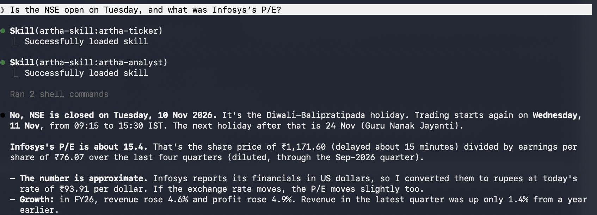
</p>

## What this is

A Claude Code plugin with eight skills. Each skill is a `SKILL.md` that tells Claude when to use it and which traps to watch for, plus a standard-library Python script that fetches the data and does the arithmetic. You ask in plain language; Claude picks the skill.

<p align="center">
  
</p>

No account, no login, no API key. Everything runs on your machine, and the skills that read your own holdings, tax lots or bank alerts make no network requests at all.

## See it work

Four everyday questions, and the Artha script that answers each one. In Claude you only ask the question: Claude picks the skill, runs it and explains the result.

<p align="center">
  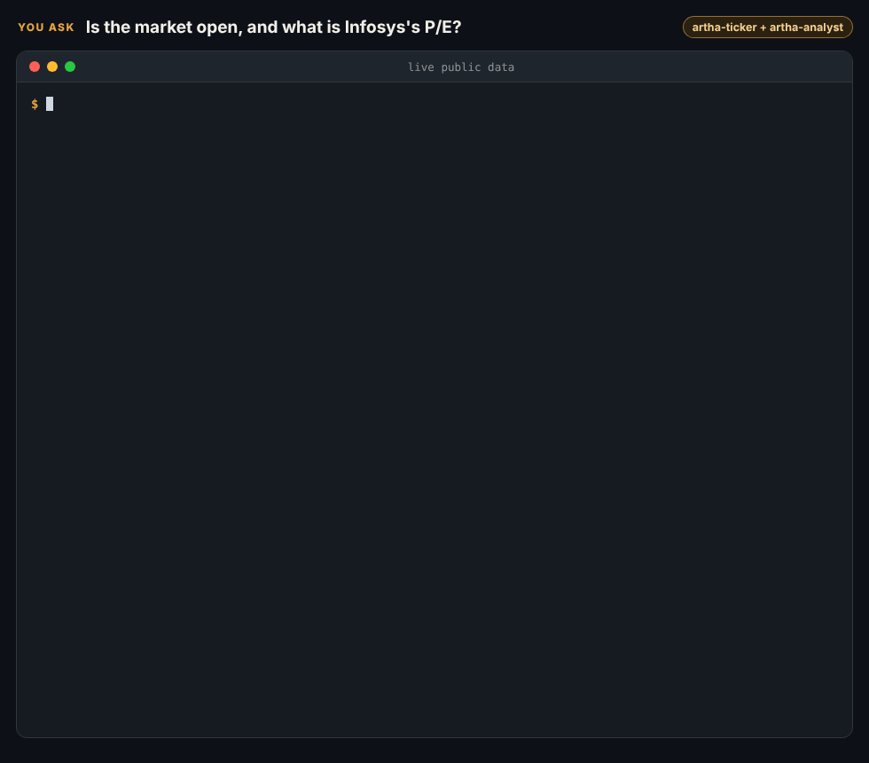
</p>

<p align="center">
  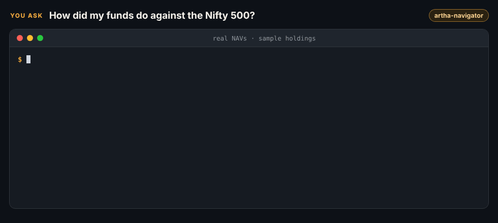
</p>

<details>
<summary><b>Two more: fund overlap, and tax before selling</b></summary>

<p align="center">
  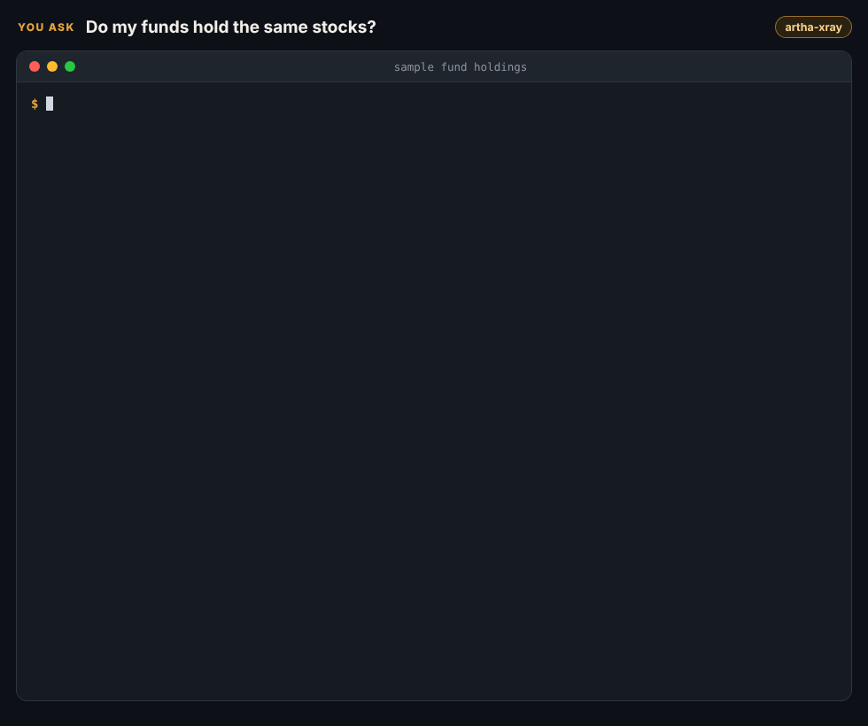
</p>

<p align="center">
  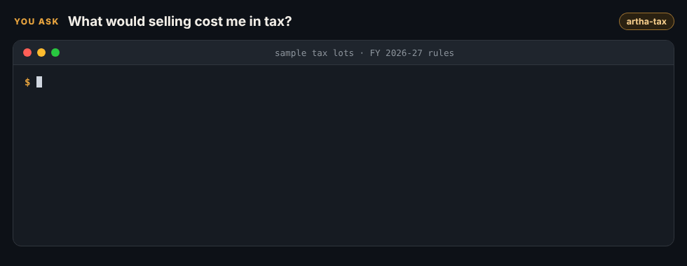
</p>

</details>

*Real runs of Artha's scripts, recorded on 21 Nov 2026. Prices, NAVs and financials are live public data; the fund holdings and tax lots are the bundled invented samples.*

## Quick start

### What you need

| | |
|---|---|
| **[Claude Code](https://code.claude.com/docs/en/overview)** | Or another Claude surface that supports plugins. |
| **Python 3.9+** | Standard library only. Nothing to `pip install`. |
| **Internet access** | To the public data sources listed under [Data sources](#data-sources). |

<details>
<summary>Fine print: network hosts, and the instruction-only edition</summary>

- **Network hosts.** `portal.amfiindia.com`, `api.mfapi.in`, `query1.finance.yahoo.com`, `query2.finance.yahoo.com`, `www.nseindia.com`, `nsearchives.nseindia.com`, `www.niftyindices.com` and `news.google.com`. If your environment restricts outbound domains, allow these.
- **Two editions.** This branch (`main`) is the full edition, with tested scripts, caches and CI. The [`directory` branch](https://github.com/gpavan1992/artha-skill/tree/directory) holds an instruction-only edition of the same eight skills, with no scripts, built for the Claude plugin directory. There, Claude fetches the data and does the arithmetic itself, so results are less repeatable, it screens about 15 stocks at a time, and it does not read NSE filings. That branch has its own history and is never merged into `main`.

</details>

### 1. Install the plugin

```bash
claude plugin marketplace add gpavan1992/artha-skill
claude plugin install artha-skill@artha
```

### 2. Ask

Start `claude` and ask in plain language:

- "Is the NSE open on Tuesday, and what is Infosys's P/E?"
- "How did my funds do against the Nifty 500 over the last 12 weeks?"
- "What would it cost in tax to sell 200 units of my ELSS fund today?"
- "Which of my funds hold the same stocks?"

### 3. Bring your own data (optional)

Artha ships with invented sample files. Copy the one you need, replace the values with yours, and keep your copy out of git. See [Customization](#customization).

If your holdings are with INDmoney, Zerodha or Groww, Claude can fill these files from your broker's connector instead. See [Use it with your broker's connector](#use-it-with-your-brokers-connector).

<details>
<summary>Other ways to run it: one session only, or without Claude</summary>

**For one session**, clone the repository from [GitHub](https://github.com/gpavan1992/artha-skill) (the green **Code** button) and start Claude Code with the plugin folder:

```bash
claude --plugin-dir ./artha-skill
```

**Without Claude**, every script is plain Python with `--help`:

```bash
python3 skills/artha-ticker/scripts/prices.py market
python3 skills/artha-analyst/scripts/fund.py INFY RELIANCE
python3 skills/artha-navigator/scripts/nav.py resolve "UTI Nifty 50 Index"
python3 skills/artha-pulse/scripts/news.py INFY --days 7
python3 skills/artha-scout/scripts/screen.py --index nifty50 --rules skills/artha-scout/rules.example.json
python3 skills/artha-tax/scripts/tax.py gains skills/artha-tax/lots.example.json --slab 30
```

</details>

## The eight skills

| Skill | What it answers | Try asking |
|---|---|---|
| **`artha-navigator`** | Real fund NAVs, 1W to 5Y returns, drawdown, portfolio vs Nifty 50 or 500 | "How did my funds do this week?" |
| **`artha-ticker`** | NSE/BSE prices, history, splits and bonuses, the NSE calendar in IST | "Is the market open on Tuesday?" |
| **`artha-analyst`** | Revenue, profit, margins, diluted EPS, P/E, ROE, debt, free cash flow | "Compare TCS and Infosys fundamentals" |
| **`artha-pulse`** | Headlines that name the company, plus NSE filings on request | "Why did Reliance move today?" |
| **`artha-scout`** | Screens Nifty indices or your list against rules you write | "Which Nifty 50 stocks pass my rules?" |
| **`artha-xray`** | Look-through stock and sector overlap across your funds | "Am I over-diversified?" |
| **`artha-tax`** | Short vs long term, ₹1.25L exemption, ELSS lock-ins, cost of selling | "What would selling this cost me?" |
| **`artha-ledger`** | Categorised spend from bank and card alert emails | "Where did my money go last month?" |

<details>
<summary><b>Full skill reference</b></summary>

- **`artha-navigator`** resolves any fund to its current AMFI scheme code, then gives 1W / 1M / 3M / 6M / 1Y / 3Y / 5Y returns and 1Y maximum drawdown, or the weekly value of a whole portfolio against the Nifty 50 or Nifty 500. Every week comes from a real NAV; nothing is estimated. Merged funds whose history stopped are rejected, and "Cumulative" is treated as Growth.
- **`artha-ticker`** returns quotes, history and week-over-week moves, handles splits and bonuses with adjusted closes, and knows the NSE trading calendar in IST, including holidays and Muhurat sessions (2026 bundled).
- **`artha-analyst`** reports annual and quarterly revenue, profit and operating margin, growth, diluted EPS, P/E, ROE, debt-to-equity and free cash flow. It converts US-dollar reporters such as Infosys at the day's rate and says so, flags bonus/split and one-off-profit traps, and skips metrics that do not apply to banks.
- **`artha-pulse`** ranks news headlines that actually name the company, and adds official NSE announcements (results, dividends, orders, management changes, ratings) when you opt in with `--nse`. It remembers what you have seen, so repeat runs show only what is new.
- **`artha-scout`** screens the Nifty 50/100/200/500, Next 50, Midcap 150, Smallcap 100 or your own list against JSON rules. It returns passes, near-misses (failing exactly one rule, with the gap) and failures with reasons.
- **`artha-xray`** shows look-through stock and sector exposure across all your funds, the rupees you effectively hold in each stock, and which fund pairs largely duplicate each other. It says how much of each fund's portfolio is disclosed, so understated overlap is never hidden.
- **`artha-tax`** estimates short and long-term gains by asset class under FY 2026-27 rules, the ₹1.25L LTCG exemption, what selling a holding would cost, loss-harvesting candidates and ELSS 3-year lock-in dates. A fund switch is treated as the taxable sale it is.
- **`artha-ledger`** turns card and UPI alert emails into a spending summary: categories, top merchants, per-card totals and refunds. It never outputs card numbers, UPI IDs or the names of people paid.

</details>

## How a number gets checked

<p align="center">
  
</p>

1. **You ask** in plain language.
2. **Claude picks a skill** from its description and reads its `SKILL.md`: when to use it, the traps it knows, and how to report.
3. **A script fetches and computes.** Numbers come from deterministic Python, not from a model's memory. Results are cached on disk for minutes to a day.
4. **The trap check runs.** A figure is flagged, converted with the rate disclosed, or withheld. It is never silently guessed.
5. **Claude explains the result**, including every warning the script raised, and ends with a reminder to verify before acting.

<details>
<summary><b>Design decisions</b></summary>

- **Scripts compute, Claude explains.** The arithmetic is repeatable and testable. The model's job is to choose the skill and report clearly.
- **Traps live where they are met.** Stale scheme codes, "Cumulative" = Growth, reporting currency, bonus-adjusted EPS and holiday gaps are written into the skill that handles them, so they are caught every time.
- **Observations, never advice.** Artha states what the data shows. It does not say buy, sell or switch.
- **No credentials, no write access.** No broker connection, no login, nothing to configure beyond optional cache folders.

</details>

## Use it with your broker's connector

Broker connectors answer **"what do I own?"**. Artha answers **"are these numbers right, and what do they mean?"**. Connect both in Claude and you can ask one question that uses both.

<p align="center">
  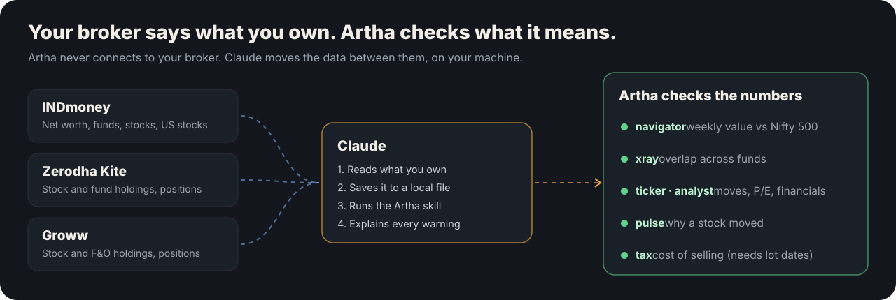
</p>

| Connector (official) | Server URL | What it gives Claude | Can it place orders? |
|---|---|---|---|
| [**INDmoney**](https://www.indmoney.com/mcp) | `https://mcp.indmoney.com/mcp` | Net worth, mutual funds, Indian and US stocks, SIPs | No. INDmoney says it is read-only |
| [**Zerodha Kite**](https://github.com/zerodha/kite-mcp-server) | `https://mcp.kite.trade/mcp` | Stock and mutual fund holdings, positions, quotes, price history | Zerodha says its hosted server leaves out "potentially destructive trading operations" |
| [**Groww**](https://groww.in/updates/groww-mcp) | `https://mcp.groww.in/mcp` | Stock and F&O holdings and positions (mutual funds were not covered at launch) | Yes. Keep its order tools set to ask before running |

Add a connector in Claude as a custom connector with the server URL above, or follow each provider's setup page. Then try:

| You ask | Connector does | Artha does |
|---|---|---|
| "Get my mutual funds from INDmoney and show how they did against the Nifty 500 over 12 weeks." | Lists your funds and current values | `artha-navigator` builds the weekly series from real NAVs |
| "Do my INDmoney funds overlap? Which stocks do I really own through them?" | Lists your funds and values | `artha-xray` adds up look-through stock and sector exposure |
| "Check my Zerodha holdings: how did they do this week vs the Nifty 500, and what are their P/Es?" | Lists your stocks and quantities | `artha-ticker` weekly moves, `artha-analyst` P/E with currency and bonus traps flagged |
| "Which of my Groww stocks are furthest below their 52-week high, and is there news on them?" | Lists your stocks | `artha-ticker` quotes each one against its 52-week range, `artha-pulse` ranks the news that names the company |
| "If I sell my oldest lots of fund X, what's the tax?" | Usually gives units and average cost only | `artha-tax` needs each purchase date. Export your broker's tradebook or capital-gains statement and ask Claude to build the lots from it |

<details>
<summary><b>How the hand-off works, and what to watch</b></summary>

- **Artha never talks to your broker.** The connector and Artha don't call each other. Claude reads your holdings through the connector, writes them to a local file in the shape Artha expects (see [Bring your own data](#bring-your-own-data)), and runs the skill on that file.
- **Keep that file out of git.** Ask Claude to save it outside the repository, or in a folder your `.gitignore` covers.
- **Connector data goes to Claude** under the connector provider's terms and Anthropic's. Artha's own scripts send nothing about your holdings anywhere.
- **Orders stay with you.** Artha has no order capability. If your connector can place orders, set those tools to ask for approval every time.
- **These are patterns, not certified integrations.** Connector tools and their output can change without notice. If Claude's file doesn't match the sample format, ask it to compare against the matching `*.example.json` and fix the file.

</details>

## Data sources

Public data only. No account, no login, no API key.

| Source | Used by | What it provides |
|---|---|---|
| **AMFI** (`NAVAll.txt`) | navigator | Active scheme list, ISINs, daily NAV |
| **mfapi.in** | navigator | Full daily NAV history per scheme |
| **Yahoo Finance** (public endpoints) | ticker, navigator, analyst | Prices, history, splits, index levels, fundamentals, USD/INR |
| **Google News** (India RSS) | pulse | Headlines that name the company |
| **NSE index lists** | scout | Constituents of Nifty 50/100/200/500, Next 50, Midcap 150, Smallcap 100 |
| **NSE corporate announcements** (opt-in) | pulse | Official filings, only with `--nse` |
| **Bundled holiday list** | ticker | NSE holidays and special sessions for 2026. 2027 is added when NSE publishes it; until then the calendar says so |

Yahoo, Google and NSE endpoints are public but unofficial. They can change or rate-limit automated requests. When one does, the skills say so instead of returning a stale number. Confirm any date you plan around on [nseindia.com](https://www.nseindia.com).

<details>
<summary><b>Responsible data use</b></summary>

- **Artha identifies itself.** Every request carries the User-Agent `artha-skill/<version> (+repository URL)`, except the opt-in NSE call below.
- **NSE filings are opt-in.** NSE refuses clients that identify themselves, so `--nse` sends a browser-style User-Agent and a cookie handshake. It is off by default, Claude asks before using it, and whether to use it is your decision: check NSE's terms first.
- **Low volume.** Requests run one at a time with a short pause between uncached fetches, and results are cached so repeat questions do not hit the source again.
- **No logins, no workarounds.** Artha never uses credentials, solves CAPTCHAs or touches an account.
- **Personal analysis.** Artha is built for analysing your own portfolio. It does not host, resell or redistribute any provider's data, and each provider's terms apply to how you use it.

Full detail is in [PRIVACY.md](PRIVACY.md).

</details>

## Screenshots

| 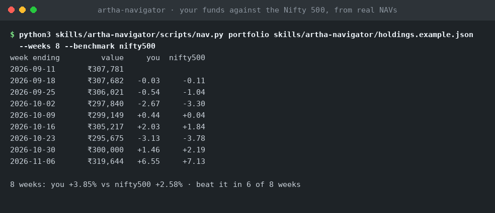 | 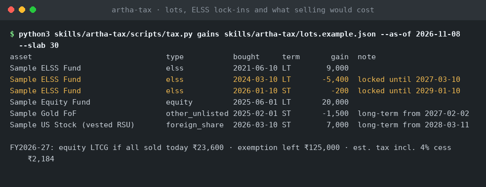 |
|---|---|
| *artha-navigator: weekly value vs the Nifty 500, from real NAVs* | *artha-tax: lots, ELSS lock-ins and what selling would cost* |

<p align="center">
  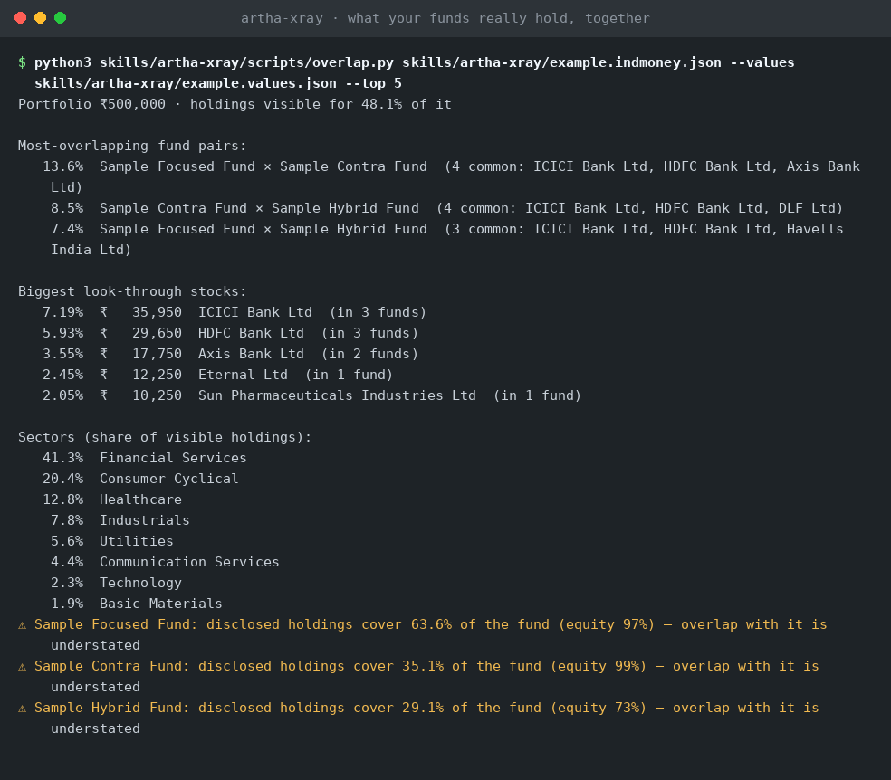<br>
  <i>artha-xray: look-through overlap, with disclosure warnings</i>
</p>

<details>
<summary>Terminal walkthrough (animated)</summary>

<p align="center">
  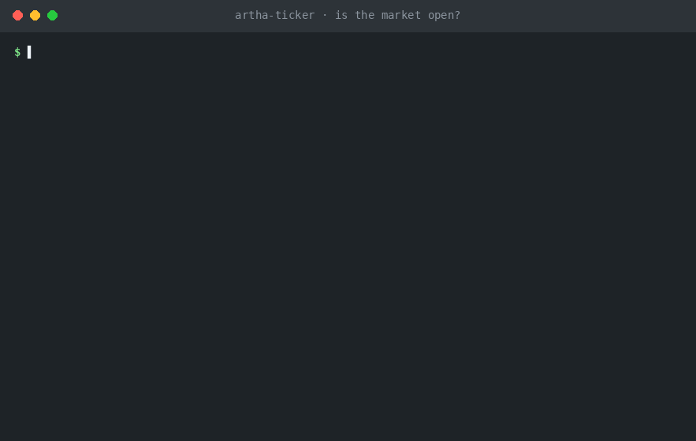
</p>

</details>

All terminal images are real script output on the bundled **sample data** (invented holdings). They are not mock-ups.

## Customization

### Bring your own data

| You provide | Used by | Start from |
|---|---|---|
| Fund units or values | navigator | `skills/artha-navigator/holdings.example.json` |
| Stock holdings | ticker | `skills/artha-ticker/stocks.example.json` |
| Tax lots (buy date, units, cost) | tax | `skills/artha-tax/lots.example.json` |
| Fund holdings and rupee values | xray | `skills/artha-xray/example.indmoney.json`, `example.values.json` |
| Screening rules | scout | `skills/artha-scout/rules.example.json` |
| Bank alert emails (as JSON) | ledger | `skills/artha-ledger/alerts.example.json` |
| Spend categories | ledger | `skills/artha-ledger/categories.json` |

`.gitignore` already excludes the cache folders. Never commit files that contain your real holdings.

### Cache folders

| Variable | Purpose | Default |
|---|---|---|
| `MFNAV_CACHE` | NAV cache (navigator) | `.mfnav-cache` |
| `PRICES_CACHE` | Price cache (ticker) | `.prices-cache` |
| `FUND_CACHE` | Fundamentals cache (analyst) | `.fund-cache` |
| `NEWS_CACHE` | News cache (pulse) | `.news-cache` |

## Privacy and safety

| Control | Status |
|---|---|
| Runs on your machine; Artha uploads nothing | ✅ |
| No API keys, passwords or tokens requested | ✅ |
| No telemetry | ✅ |
| Card numbers, UPI IDs and payee names never output | ✅ |
| Bundled examples use invented data only | ✅ |
| Read-only: no orders, no account access | ✅ |
| Open source: every line auditable | ✅ |
| Data-source guarantees | ○ Public, unofficial endpoints; can change without notice |
| Tax outputs accepted for filing | ○ Estimates only; confirm with a chartered accountant |

[PRIVACY.md](PRIVACY.md) lists exactly what stays on your machine and what each source receives. Report vulnerabilities privately as described in [SECURITY.md](SECURITY.md).

## Is this for you?

**Good fit if you** invest in Indian mutual funds and stocks, want checkable numbers behind your own decisions, use Claude Code, and want warnings rather than silent guesses when data is stale, converted or approximate.

**Not a fit if you** want buy, sell or "which fund is best" recommendations, want to place orders, need a point-and-click dashboard, or need figures to file a tax return.

<details>
<summary>Compared to a typical portfolio-tracker app</summary>

| | **Artha** | Typical tracker app |
|---|---|---|
| **Where your holdings live** | In files on your machine | On the vendor's servers |
| **Source code** | Fully open, MIT | Usually closed |
| **Pricing** | Free | Often a free tier plus subscription |
| **How you ask** | Plain language to Claude | Fixed screens and filters |
| **Customization** | Edit the rules, categories and tax lots, or fork it | Feature requests into someone else's backlog |
| **Exit** | Delete the folder | Account closure and data export |

Artha does not compete on a polished app. It competes on being right and showing its work.

</details>

## Roadmap

- ✅ **v0.1** Fund NAVs and returns, NSE/BSE prices and 2026 calendar, financials with currency and bonus traps, company news with opt-in NSE filings, a screener over seven NSE indices, fund overlap, FY 2026-27 capital-gains estimates, spend parsing, plugin validation and live smoke tests
- ⏳ **Claude plugin directory** Instruction-only edition submitted from the `directory` branch, in review
- [ ] 2027 NSE holiday list, checked against NSE's circular
- [ ] Price and rule alerts between runs
- [ ] SIP-aware returns (XIRR) alongside the weekly portfolio series
- [ ] Optional MCP connector so the same data works outside Claude Code
- [ ] More asset classes: bonds, REITs and gold ETFs in the portfolio series

*Roadmap items are intentions, not commitments.*

## File structure

<details>
<summary>Show the repository layout</summary>

```
artha-skill/
├── .claude-plugin/
│   ├── plugin.json            # plugin manifest
│   └── marketplace.json       # lets `claude plugin marketplace add` find it
├── skills/
│   ├── artha-navigator/       # SKILL.md, scripts/nav.py, holdings.example.json
│   ├── artha-ticker/          # SKILL.md, scripts/prices.py, data/nse_holidays.json
│   ├── artha-analyst/         # SKILL.md, scripts/fund.py
│   ├── artha-pulse/           # SKILL.md, scripts/news.py
│   ├── artha-scout/           # SKILL.md, scripts/screen.py, rules.example.json
│   ├── artha-xray/            # SKILL.md, scripts/overlap.py, example files
│   ├── artha-tax/             # SKILL.md, scripts/tax.py, lots.example.json
│   └── artha-ledger/          # SKILL.md, scripts/parse.py, categories.json
├── tests/
│   ├── static_check.py        # offline checks, run in CI
│   └── smoke.sh               # live checks against public data
├── assets/readme/             # diagrams in this README
├── assets/demo/               # GIFs of real script runs
├── screenshots/               # real terminal output on sample data
├── AGENTS.md                  # rules for AI coding agents working here
├── CONTRIBUTING.md
├── PRIVACY.md
├── SECURITY.md
└── LICENSE
```

</details>

## Contributing

The most valuable contribution is a **data trap**: a number that looked right and was not. Open an issue with the *Data source broke* template, or see [CONTRIBUTING.md](CONTRIBUTING.md) to add tax rules, screener metrics or fund-house aliases. AI coding agents should read [AGENTS.md](AGENTS.md) first.

Before a pull request, run:

```bash
python3 tests/static_check.py
bash tests/smoke.sh        # needs network
```

## Built by

**Pavan Galiveeti**, Lead PM building AI products. Built in public with [Claude](https://claude.com) as pair programmer. Feedback welcome on [LinkedIn](https://linkedin.com/in/pavangaliveeti) or in [issues](https://github.com/gpavan1992/artha-skill/issues).

## License

[MIT](LICENSE). Free to use, modify and redistribute, including commercially. Keep the copyright notice.

<p align="center">
  <br>
  <sub>Not investment advice. Data comes from public sources that can be wrong or delayed. Verify before you act.</sub>
</p>
